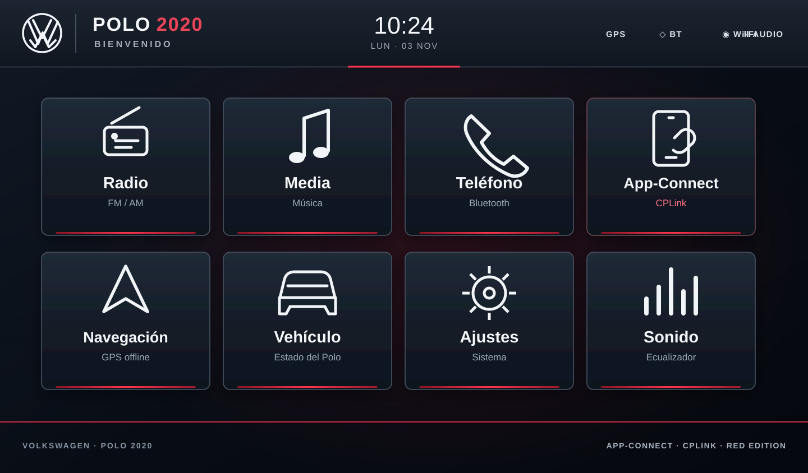

# Volkswagen Polo 2020 · WV232

**Launcher Android de estilo OEM inspirado en Volkswagen Discover Media / MIB2**, desarrollado para una unidad multimedia Android WV232. Interfaz horizontal, tema grafito y acentos rojo Volkswagen.

## Vista previa de la interfaz

  

<em>Preview visual del launcher: menú OEM, ocho accesos principales y acentos rojos.</em>

## Funciones

- **Inicio OEM:** emblema VW, POLO 2020, bienvenida, hora, fecha e indicadores de conectividad.
- **Radio y Media:** accesos a las aplicaciones originales de la unidad.
- **Teléfono:** acceso a la aplicación Bluetooth del estéreo.
- **App-Connect:** conserva CPLink como receptor de Apple CarPlay. El launcher intenta localizarlo por nombre/paquete; si no lo identifica, permite vincular la aplicación instalada y guardar la selección.
- **Navegación:** acceso a Organic Maps (`app.organicmaps`) o a otra aplicación de mapas elegida.
- **Vehículo y datos de viaje:** pantallas preparadas para mostrar información real del decodificador CANBUS. No se inventan estados ni mediciones.
- **Cámara de reversa:** respeta la conmutación automática original del estéreo; la APK no intercepta la entrada RCA ni la señal de reversa.
- **Ajustes:** vinculación de las aplicaciones originales y acceso a la configuración Android.

## Compilar el APK en GitHub

El repositorio incluye un workflow de GitHub Actions que compila la versión de depuración.

1. Abre la pestaña **Actions**.
2. Selecciona **Build VAG OEM WV232 APK**.
3. Pulsa **Run workflow** para iniciar una compilación manual (también se ejecuta al actualizar `main`).
4. Cuando termine correctamente, abre la ejecución y descarga el artefacto **VAG-OEM-WV232-0.3.1-debug-APK**.

El archivo dentro del ZIP del artefacto se llama `app-debug.apk`.

### Herramientas de compilación

- JDK 17
- Gradle 8.9
- Android Gradle Plugin 8.7.3
- Android SDK Platform 35
- `minSdk 23` · `targetSdk 32`

## Estado y compatibilidad

- Proyecto en desarrollo y pruebas; no es firmware ni sustituye el sistema original de la unidad.
- La primera compilación debug se ha generado mediante GitHub Actions; debe instalarse y probarse en la unidad WV232 real.
- El chipset, ABI, API real de Android, resolución física y densidad de pantalla de cada variante WV232 deben verificarse en el dispositivo.
- La integración directa de datos CANBUS está pendiente de identificar la aplicación/servicio del decodificador y su interfaz de lectura.
- CPLink debe estar instalado en el estéreo para que App-Connect pueda abrirlo.
- El APK actual es de depuración; una versión de producción requerirá configurar una clave de firma estable.

## Estructura del proyecto

- `app/`: aplicación Android nativa (Java), pantallas y recursos.
- `docs/vag-oem-wv232-preview.svg`: imagen de preview mostrada arriba.
- `preview/`: prototipo visual navegable.
- `.github/workflows/build-apk.yml`: compilación automática del APK.

## Seguridad

No se modifican firmware, MCU, Factory Settings ni parámetros del vehículo. La integración CANBUS se plantea como lectura únicamente hasta confirmar el protocolo y la documentación del decodificador.
