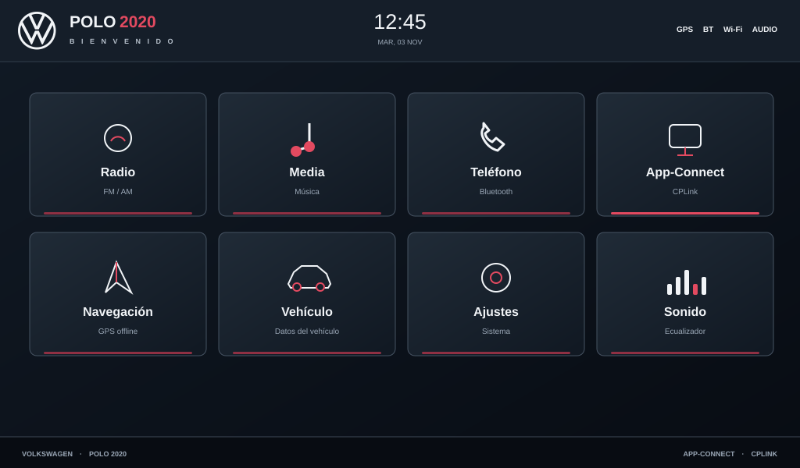
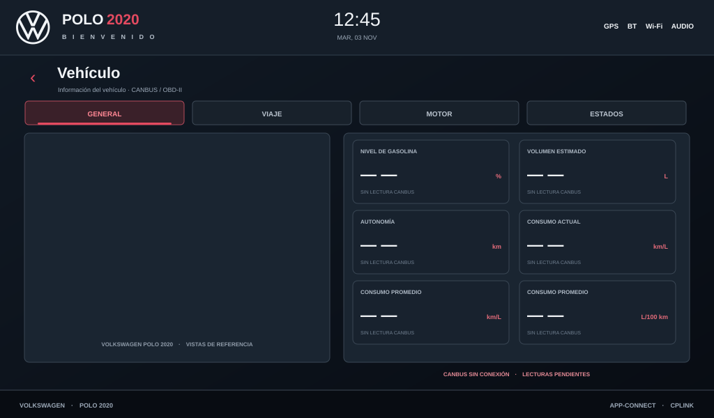
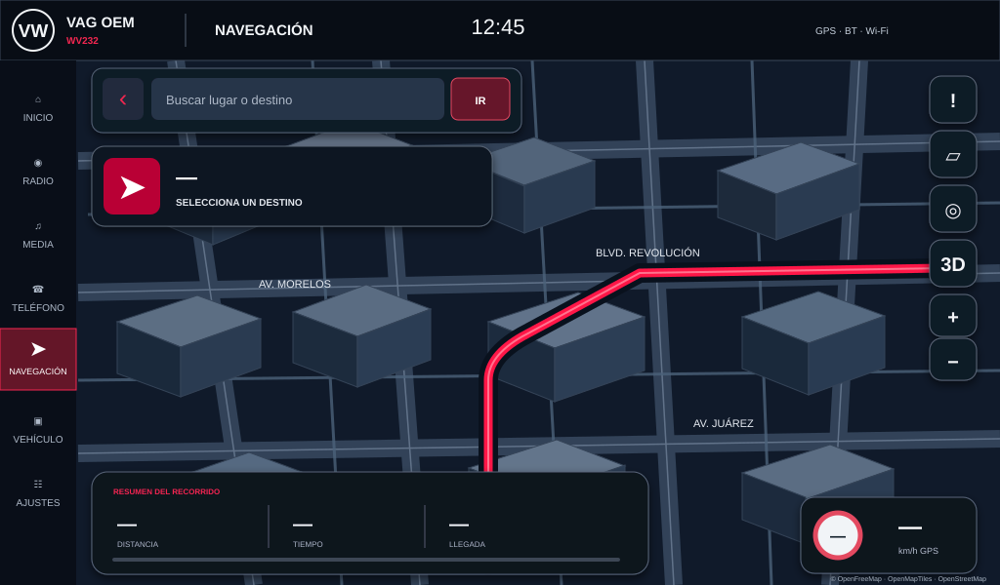
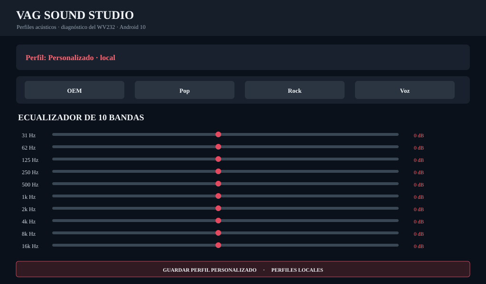

# VAG OEM · Volkswagen Polo 2020 · WV232 / 9070

Aplicación Android nativa Java, una sola APK, con interfaz estilo OEM Volkswagen. Versión objetivo **0.13.1**.

## Vista previa de la interfaz

Estas imágenes muestran vistas de referencia de las pantallas principales de VAG OEM, preparadas a partir del diseño y los componentes presentes en el código de la versión 0.13.0. **Son previews de interfaz, no capturas de una ejecución en el estéreo ni del emulador.** La validación visual en Android Emulator y en el WV232 físico se documentará por separado cuando sus pruebas terminen.

  <strong>VAG Home · Launcher principal</strong> 
  

  <strong>VAG Vehicle · Tablero de información</strong> 
  

  <strong>VAG Navigation · Mapa y controles</strong> 
  

  <strong>VAG Sound Studio · Ecualizador de 10 bandas</strong> 
  

> Nota: el tablero de vehículo muestra guiones mientras no se haya identificado e integrado un decodificador CANBUS/OBD compatible. La vista de navegación mostrada arriba es una composición conceptual; no es una captura real del mapa ni una ruta verificada. El mapa real de la app usa MapLibre con el estilo oscuro Dark de OpenFreeMap y edificios vectoriales 3D cuando la fuente contiene alturas y requiere conexión o paquetes offline compatibles. La ruta solo aparece después de calcularse con datos Valhalla disponibles.

## Accesos configurables

Mantén presionado durante aproximadamente **0.6 segundos** un acceso del launcher para elegir la aplicación que debe abrir. La selección se guarda de forma local y no sustituye ni desinstala la aplicación original del equipo.

- Radio, Música, Teléfono y App-Connect: asignan la app correspondiente.
- Navegación: permite elegir un navegador externo; cuando no hay uno asignado, abre VAG Navigation.
- Vehículo: mantiene el tablero VAG Vehicle; desde el aviso inferior **APP CANBUS** se abre la aplicación CANBUS vinculada.
- Ajustes: permite elegir los ajustes OEM del fabricante.
- Sonido: permite elegir una aplicación DSP externa; si no se configura, abre VAG Sound Studio.

Para restablecer una asignación, vuelve a mantener presionado el acceso y selecciona la aplicación deseada. Los vínculos se guardan en preferencias locales.

## Inspiración y créditos

Se agradece a **Elías Salvatierra** por compartir el proyecto [InterfazRanger](https://github.com/eliassalvatierra/InterfazRanger). Su trabajo sirvió como referencia para evaluar patrones útiles de launcher automotriz, especialmente la personalización de accesos mediante pulsación prolongada, la integración de aplicaciones y la atención al consumo de recursos.

VAG OEM implementa estas ideas de forma independiente en Java y conserva su propia interfaz, recursos gráficos y arquitectura. **No se copiaron código fuente, imágenes ni protocolos del proyecto original.** El repositorio de referencia no declara una licencia de reutilización, por lo que se utiliza como inspiración y se acredita al autor, no como código incorporado.

También se identificaron como posibles mejoras futuras la tarjeta multimedia con metadatos y carátula, y el control de las tareas al pasar a segundo plano. Su integración queda sujeta a comprobar el soporte real de las aplicaciones del WV232. El protocolo de radio NWD descrito en InterfazRanger no se reutiliza: depende de paquetes y hardware específicos que no están confirmados en el WV232.

## Módulos
- VAG Home: launcher OEM horizontal.
- VAG Navigation: MapLibre Native 13.6.1.
- VAG Map Manager: regiones offline, progreso, biblioteca y eliminación.
- VAG Road Alerts: reportes manuales geolocalizados locales.
- Valhalla Mobile 0.6.3: motor nativo de rutas offline.
- VAG Sound Studio: perfiles locales y EQ de 10 bandas.
- Audio Lab: diagnóstico de micrófono.
- VAG Vehicle: tablero OEM de combustible, km/L, autonomía, viajes, motor y estados; lecturas CANBUS reales pendientes de identificar e integrar.

## Una sola APK y datos offline

### Motor de rutas regional
La APK integrada 0.13.1 se construye con el grafo Valhalla de Durango-Coahuila como asset `vag_valhalla_tiles.tar`; el flujo de CI renombra el TAR generado al nombre que consume `OfflineRoutingEngine`. En el primer cálculo de ruta, la app copia el asset al almacenamiento privado y ejecuta el motor local. No necesita red para calcular una ruta cuando el paquete cubre origen y destino.

El flujo de GitHub Actions `.github/workflows/build-offline-route-data.yml`:
1. Descarga el extracto OSM de México desde Geofabrik.
2. Recorta Durango-Coahuila y los corredores viales cercanos.
3. Construye el grafo con Valhalla.
4. Publica el TAR de red vial.
5. Descarga ese TAR en el job Android y lo integra en la APK final.

El artefacto final de ese flujo se llama `VAG-OEM-WV232-0.13.1-LAGUNA-OFFLINE-APK`. El flujo debe terminar correctamente antes de instalar la APK integrada.

### Mapas visuales
MapLibre Native y la interfaz están incluidos en la APK. Los mapas vectoriales visibles usan el estilo Dark oscuro de OpenFreeMap, con edificios extruidos en 3D cuando hay alturas disponibles, jerarquía vial, etiquetas y puntos de interés. La interfaz incluye cabecera OEM, rail lateral, buscador, panel de maniobra, controles flotantes y resumen de ruta. El administrador ofrece regiones compatibles con Dark. El cambio de estilo requiere volver a descargar las regiones visuales guardadas con Bright. El administrador ofrece:
- Durango estatal (vista general).
- Coahuila estatal (vista general).
- La Laguna (vista general).\n- Torreón, Gómez Palacio y Lerdo como tres paquetes urbanos independientes (zoom 9–16), para descargar y conservar por separado.\n- La descarga de cada ciudad se mantiene dentro de los límites publicados por OpenFreeMap; si un paquete supera 3,000 teselas o 50 MB, se detiene y debe ajustarse su extensión o nivel de zoom.
- Durango capital (detalle urbano).
- Saltillo (detalle urbano).

Estos paquetes se descargan desde VAG OEM y quedan en la base offline SQLite de MapLibre para utilizarlos sin internet una vez completados. **Los tiles visuales no están precargados dentro del APK 0.13.1**; se descargan por ciudad para mantener una instalación manejable y permitir actualizaciones. La APK integrada sí incorpora el grafo vial regional de Valhalla. El motor de rutas sí se integra en la APK final del flujo de datos.

OpenFreeMap permite descargas offline de hasta 3,000 teselas o 50 MB por descarga, con un máximo de cuatro solicitudes paralelas y User-Agent identificable. VAG OEM configura User-Agent propio, cuatro solicitudes simultáneas y elimina paquetes que superan el límite. <https://openfreemap.org/tos/>

### Alertas
- Reportes manuales: peligro, bache, obra/cierre, inundación, accidente, vehículo detenido, retén/control y otro.
- Coordenadas GPS y nota opcional.
- Marcadores y lista persistente en el dispositivo.

Son reportes locales; no son alertas Waze ni se comparten en vivo. Para tráfico y alertas comunitarias hace falta un backend/feed y conectividad.

## Navegación

VAG Navigation 0.13.1 adopta un cockpit automotriz nocturno inspirado en navegadores 3D: cartografía OpenFreeMap Dark, cámara inclinada, edificios vectoriales extruidos, seguimiento GPS con orientación por rumbo, ruta roja Volkswagen, buscador flotante, tarjeta de maniobra, controles laterales y resumen inferior del recorrido.

### Cartografía y perspectiva
- MapLibre Native 13.6.1 con estilo **Dark** de OpenFreeMap para una base nocturna de alto contraste.
- La implementación 3D toma como referencia técnica el ejemplo oficial [MapLibre Native Android — Building Layer](https://maplibre.org/maplibre-native/android/examples/styling/building-layer/) y la guía [3D Buildings](https://docs.maptoolkit.org/platform-libraries/maplibre-native-android/examples/add-3d-buildings/).
- La fuente vectorial de OpenFreeMap usa el identificador `openmaptiles`, la capa `building` y los atributos `render_height` / `render_min_height`; la extrusión se inserta debajo de las etiquetas de calles para no taparlas.
- Se evaluó [MapLibre Navigation Android](https://github.com/maplibre/maplibre-navigation-android), SDK open source para instrucciones giro a giro, pero no se añadió todavía: la app conserva Valhalla Mobile para cálculo local y primero debe validarse la compatibilidad de versiones y el flujo de navegación continua.
- Para futuras funciones se consultaron [MapLibre Plugins for Android](https://github.com/maplibre/maplibre-plugins-android), que incluye plugins Building, Offline y Traffic; Traffic requiere una fuente de tráfico real y no crea datos por sí mismo.
- Capa `fill-extrusion` propia sobre el source vectorial `openmaptiles`, source-layer `building`, usando `render_height` y `render_min_height`. Los edificios aparecen desde zoom 14 cuando la región tiene alturas OSM disponibles.
- Cámara inicial inclinada a 58 grados y zoom urbano; el control 3D alterna perspectiva y vista cenital.
- La ruta Valhalla conserva el trazo rojo Volkswagen con contorno oscuro.
- El indicador de velocidad usa la última velocidad GPS reportada por Android; el límite de velocidad permanece sin dato hasta integrar una fuente fiable de señales viales.

### Interacción
- Búsqueda por dirección con Geocoder Android o por coordenadas `latitud,longitud`.
- Selección de destino tocando el mapa.
- Panel superior de maniobra: muestra la primera instrucción que entrega Valhalla cuando hay una ruta calculada; no inventa distancias de giro.
- Panel inferior: distancia, duración estimada y hora de llegada calculada a partir del tiempo de ruta.
- Controles laterales para reportes, capas, centrar GPS, perspectiva 3D y zoom.
- Gestor de mapas offline actualizado al estilo Dark.

### Límites reales
El mapa vectorial y la extrusión 3D funcionan con conexión o con teselas offline compatibles. La perspectiva 3D extruye edificios OSM con alturas etiquetadas; no genera geometría donde el conjunto de datos no contiene alturas. La altura y densidad de edificios dependen de los datos OSM de cada zona; no es una vista satelital ni edificios fotorealistas. El seguimiento GPS en primer plano actualiza el marcador del vehículo y la velocidad reportada por Android; todavía no existe seguimiento de ruta giro a giro, recálculo automático, voz, tráfico en vivo ni alertas comunitarias. El panel de velocidad no muestra un límite legal si no existe una fuente de señales validada.

**Migración de mapas offline:** las regiones descargadas con el estilo Bright de versiones anteriores no corresponden al nuevo estilo Dark. Después de actualizar, elimina y vuelve a descargar las regiones visuales para conservarlas sin conexión.

## Vehículo y datos CANBUS / OBD-II
La vista Vehículo presenta los campos de nivel de combustible, volumen estimado, autonomía, consumo instantáneo/promedio (km/L y L/100 km), viajes A/B, tiempo, distancia, velocidad promedio/máxima, RPM, temperatura de refrigerante, carga, acelerador, voltaje y estados de puertas/luces. Los valores se muestran como no disponibles hasta tener un decodificador CANBUS/OBD compatible y confirmar los PIDs/señales que entrega la radio. No se inventan lecturas. El volumen en litros y la autonomía requieren calibrar la capacidad del tanque y validar las señales de nivel/consumo.

La silueta roja de tres vistas se basa en la lámina del Polo proporcionada para el diseño. En Teléfono se habilitan accesos al marcador, historial, contactos y favoritos mediante las aplicaciones nativas de Android.

## Sonido
- EQ visual de 10 bandas, -6 a +6 dB.
- Perfiles OEM equilibrado, Pop, Rock, Voz y Personalizado.
- Diagnóstico de efectos Android, códecs y salidas.
- No procesa globalmente radio/CPLink: hace falta acceso al DSP o servicio privilegiado del fabricante.

## Compatibilidad y protección
- Android 10 del WV232 está dentro del rango soportado.
- minSdk 24, targetSdk 32.
- CPLink original no se modifica.
- No se modifica firmware, MCU, Factory Settings ni CANBUS.
- Cámara de reversa conserva su conmutación original.
- CANBUS de solo lectura pendiente.

## Builds
- APK base automática: `VAG-OEM-WV232-0.13.1-BASE-debug-APK` (sin grafo precargado).
- APK con grafo regional: `VAG-OEM-WV232-0.13.1-LAGUNA-OFFLINE-APK` (flujo de construcción de datos).
- JDK 21 (CI) · Gradle 8.11.1 · Android SDK 36.

## Validación
Código y workflows guardados en GitHub. La compilación final del APK con grafo regional y pruebas en hardware WV232 siguen pendientes de confirmación. No se declara éxito de build hasta que Actions lo reporte.
